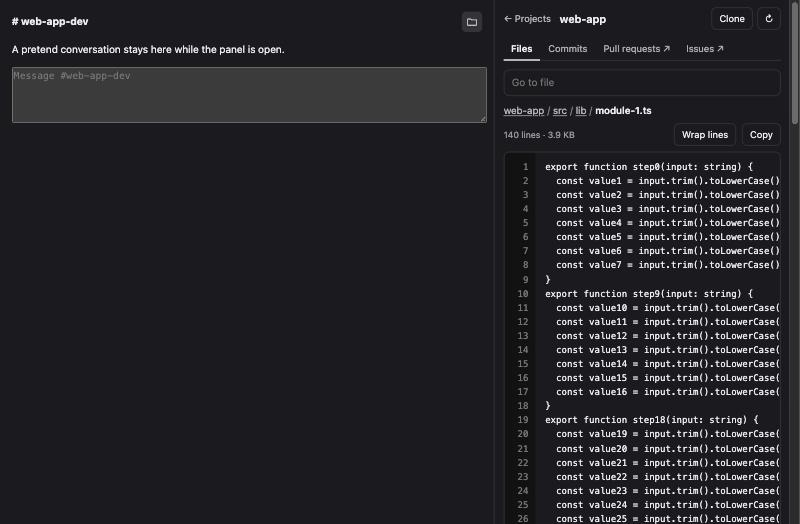
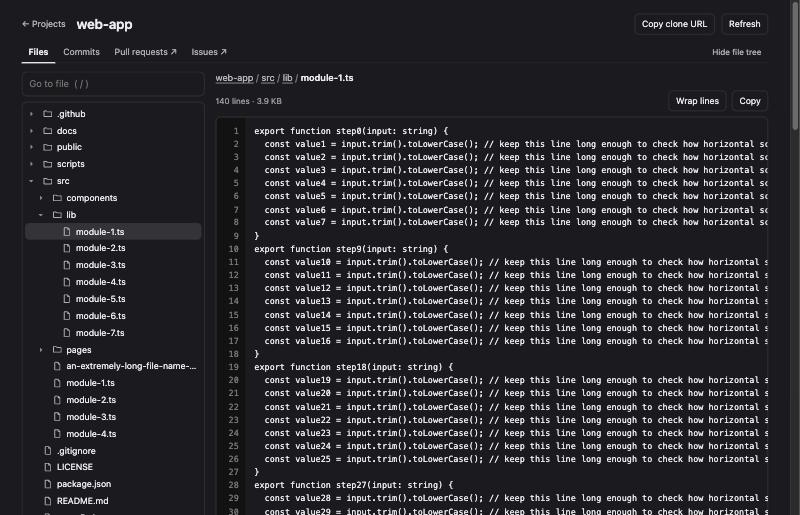

# Projects for Buzz

Browse your community's projects, repositories and files right beside your conversations.

[Buzz 1.0](https://github.com/block/buzz-app) can open a repository from a link, but it has no
page that lists them. This plugin adds that page, with a real file browser, as a side panel
or a full page.



## Features

- **Works beside your chat.** Open it from any channel header and keep talking while you browse.
- **All your projects in one place.** See each project's repositories and linked channels.
- **The current channel comes first.** Repositories linked to the channel you're in appear at the top.
- **A proper file browser.** Folder tree, breadcrumbs and file view with line numbers.
- **Find files fast.** Search by name, then use the arrow keys and Return.
- **Readable docs.** READMEs and Markdown files display formatted.
- **Commit history.** Commits grouped by day, with collapsible per-file diffs.
- **It keeps your place.** Your repository, folder and file stay put when you switch views.



## Install

Requires Buzz 1.0 on the desktop.

On a Mac, run:

```sh
open 'buzz://plugin-install?repository=nickhenggeler%2Fbuzz-projects-plugin&ref=main'
```

Or open **Settings → Plugins → Manage plugins**, add the repository
`nickhenggeler/buzz-projects-plugin`, then review and install it.

Buzz doesn't pull updates by itself. To move a plugin you installed from a folder over to
this repository, remove it first, then install it from here.

## Use it

- **Beside a conversation:** click the folder button in a channel header.
- **From anywhere:** click **Projects** in the top bar.
- **Full window:** open **Projects** in the sidebar.

On the full page, press `/` to jump to file search.

## Limits

- Projects is read-only. It can't create or edit projects yet.
- Buzz allows about 12 seconds per repository read, so very large repositories or slow servers
  can fail to load. Use **Try again** if that happens.
- Pull requests and issues open in Buzz's built-in repository page.
- Repository links in chat still open Buzz's built-in viewer.
- Markdown support covers common formatting. Images and raw HTML aren't shown.
- There is no syntax highlighting yet.

## Development

The plugin is one dependency-free file, `plugin.js`, with no build step.

- Run the tests on macOS with `tests/run.sh`.
- To try the interface with sample data, serve this folder and open `tests/preview.html`.
  Add `?panel=1` for the side panel, or `?delay=4600` to simulate a slow server.

## Related

[Code Lite](https://github.com/nickhenggeler/buzz-code-lite) adds a lightweight code editor to Buzz.

## License

[Apache-2.0](LICENSE). This is an independent community plugin, not an official Block project.
